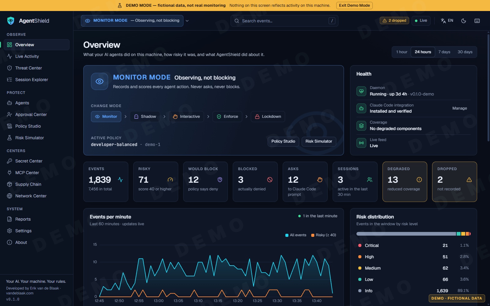

<p align="center"></p>

<h3 align="center">Local AI Agent Security &amp; Observability</h3>
<p align="center"><b>Your AI. Your machine. Your rules.</b></p>

**Erik's AgentShield** shows what your AI coding agent (Claude Code) actually does on your machine — every shell
command, file access, web fetch and MCP call — scores the risk with an explainable engine, and, when you
choose, enforces your policy *before* the action runs. Everything stays local: no account, no cloud, no
telemetry.

> Nederlands: zie [README.nl.md](README.nl.md).



## What it does

| | |
|---|---|
| **Observe** | Live activity of Claude Code tool calls via official hooks, with intent (before) and confirmed outcome (after) kept separate. |
| **Explain** | Deterministic 0–100 risk score per action with step-by-step explanation, confidence and safer alternatives. |
| **Decide** | Declarative TOML policies, 9 presets (Balanced, Strict, Laravel, Python, Rust, Read Only, Production Server, Database Safety, Observe Everything), user + project layers. |
| **Enforce** | Five modes: Monitor · Shadow · Interactive · Enforce · Lockdown. |
| **Prove** | Append-only SQLite audit log with a tamper-evident hash chain; redacted JSON/CSV/SARIF/HTML exports and reports. |

### The five modes

| Mode | Blocks? | What happens |
|---|---|---|
| **Monitor** (default) | never | Records and scores everything. |
| **Shadow** | never | Records what the policy *would* do (would-deny / would-ask). |
| **Interactive** | via Claude Code | Risky actions are sent to Claude Code's own approval prompt (`ask`); hard rules deny. |
| **Enforce** | yes | Policy `deny` → blocked before execution; `ask` → native prompt. |
| **Lockdown** | yes | Every mutating, network or risky action is denied until you switch back. |

AgentShield **never** returns `allow` and never rewrites tool input, so it can only make Claude Code
stricter — never weaker than its own permission settings.

## MCP tool-poisoning protection

`agentshield mcp wrap` routes stdio MCP servers through a local proxy that pins every tool definition,
flags poisoned or changed ("rug pull") definitions, and — in Enforce/Lockdown — hides them from the model.
Verified live with Claude Code. See [docs/MCP_PROXY.md](docs/MCP_PROXY.md).

## Known vulnerabilities & malware (offline OSV)

`agentshield osv update` downloads the public [OSV](https://osv.dev) data once (npm, PyPI, crates.io,
Packagist, NuGet, RubyGems, Go — ~286 000 advisories incl. ~240 000 known malicious packages) into a local
database. From then on every package the agent installs is checked **offline**: known malware is critical
(hard-denied in Enforce), pinned versions with CVEs are scored by severity with the fixed version as the
safer alternative. Nothing is downloaded unless you run the command.

## Honest coverage

AgentShield sees what Claude Code's hooks expose. It does **not** see what child processes do beyond
their command line, does not capture network traffic, and does not sandbox. The
[capability matrix](docs/AGENT_CAPABILITY_MATRIX.md) shows exactly what is enforced, observed, partial or
unsupported — in the app too. Other agents (Codex, Cursor, …) are detected but **not monitored**.

## Install & first run

```powershell
# Windows: run the per-user installer from dist\ (NSIS) — no admin rights needed. Or from source:
cargo build --release -p agentshield
target\release\agentshield.exe agent install claude-code --dry-run   # shows exactly what changes
target\release\agentshield.exe agent install claude-code              # asks for confirmation, backs up first
target\release\agentshield.exe status
target\release\agentshield.exe selftest                               # real hook → engine → audit log
```

The installer adds AgentShield hooks to `~/.claude/settings.json` (exec form, no shell), keeps every
existing hook and permission, backs the file up first and verifies the result. `agentshield agent
uninstall claude-code` removes only AgentShield's entries.

**Code signing policy:** releases up to 0.1.0 are unsigned; signing through the SignPath Foundation is
pending. See [CODE_SIGNING_POLICY.md](CODE_SIGNING_POLICY.md) (what is signed, roles, privacy policy).

### Uninstall

- **Windows (NSIS setup.exe, recommended):** the uninstaller stops the daemon, removes exactly the hooks
  and MCP wrappers of *that* installation (other tools' hooks and other AgentShield copies stay), restores
  the original MCP commands and keeps your audit log. Upgrading over an existing install keeps monitoring on.
- **MSI and Linux .deb/AppImage:** these package formats cannot safely edit a user's home directory.
  Run `agentshield agent uninstall claude-code` and `agentshield mcp unwrap` first, then remove the package.
  (A leftover hook makes Claude Code report a hook error; it does not block unless you chose `--fail-closed`.)
- Your data (`%LOCALAPPDATA%\AgentShield` / `~/.local/share/agentshield`) is never deleted automatically.

## CLI

```
agentshield status | doctor | detect | watch | dashboard | selftest
agentshield mode monitor|shadow|interactive|enforce|lockdown
agentshield agent list | install claude-code [--dry-run] [--fail-closed] | repair | uninstall
agentshield policy list | show [preset] | validate <file> | simulate "<cmd>" | use <preset>
agentshield command analyze "<cmd>" [--shell bash|powershell|cmd]
agentshield events list | show <id> · sessions list · security check
agentshield report generate daily|weekly|project|agent_comparison|shadow|incident|coverage
agentshield export json|csv|sarif|html
agentshield daemon run|start|stop|status
```
All commands support `--json`. Exit codes: 0 ok · 1 error · 2 usage · 3 daemon unavailable · 4 check failed/risky · 10 aborted.

## Measured performance (Windows 11, release build)

| | p50 | p95 | p99 |
|---|---|---|---|
| Hook end-to-end incl. process start | 14.4 ms | 16.5 ms | 16.6 ms |
| Daemon-side hook handling | 0.63 ms | 0.85 ms | 2.8 ms |
| Policy + risk evaluation (debug build) | 0.40 ms | 0.59 ms | 0.79 ms |

100 000 audit events insert in ~1 s; a filtered page loads in < 1 ms. Details: [docs/PERFORMANCE.md](docs/PERFORMANCE.md).

## Development

Open `AgentShield.code-workspace` (or the folder) in VS Code: recommended extensions, rust-analyzer for both
Cargo workspaces, tasks (`Kwaliteitspoort`, `Linux-validatie`, hook fixtures, desktop dev) and debug
configurations — all using an isolated test profile in `target/dev`. See [CLAUDE.md](CLAUDE.md).

## Documentation

[Security architecture](docs/SECURITY_ARCHITECTURE.md) · [Threat model](docs/THREAT_MODEL.md) ·
[Policies](docs/POLICIES.md) · [Research](docs/RESEARCH.md) · [Competitors](docs/COMPETITOR_ANALYSIS.md) ·
[Security findings](docs/SECURITY_FINDINGS.md) · [Code signing policy](CODE_SIGNING_POLICY.md) · [Progress](docs/PROGRESS.md) · [Technical debt](docs/TECHNICAL_DEBT.md)

## License

Apache-2.0. Developed by **Erik van de Blaak** — [vandeblaak.com](https://www.vandeblaak.com).
